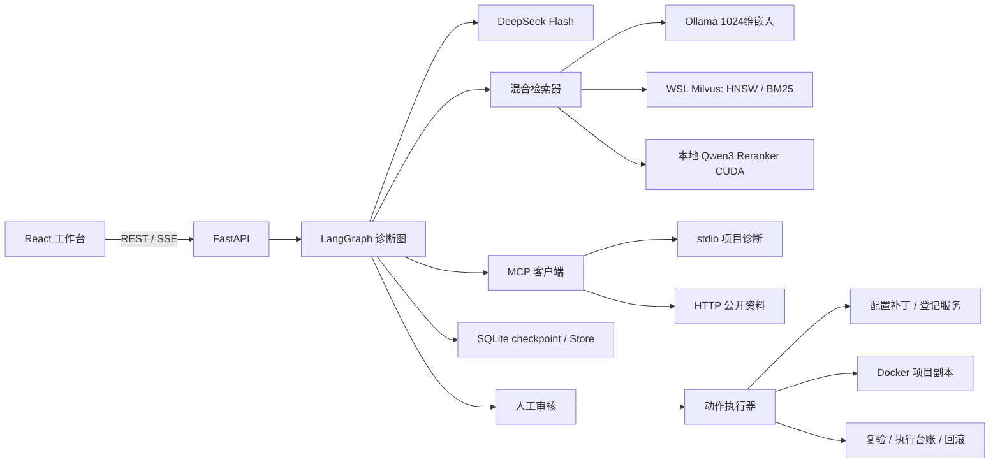
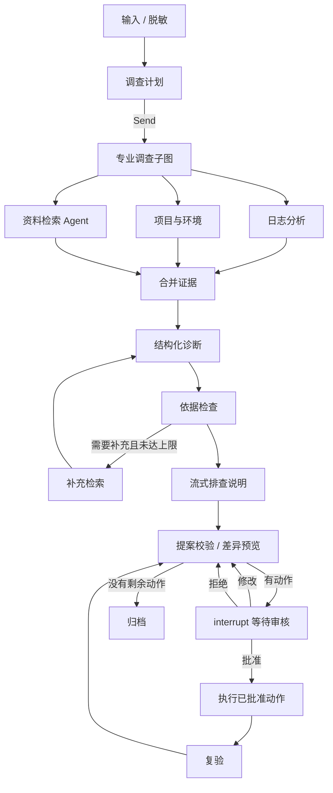

# TraceForge 架构与实现

## 目标与部署边界

系统将自然语言理解、资料检索与可审核的程序动作连接起来。诊断结论关联具体证据；项目路径由用户登记；修复在确认后执行；服务状态、执行输出与复验结果作为后续判断依据。

Windows 运行 React 构建产物、FastAPI、DeepSeek 客户端、Ollama 嵌入与 CUDA 重排。现有 WSL Ubuntu 运行 Docker Engine、Milvus 和隔离命令容器。入口默认仅监听127.0.0.1，前端静态资源与后端 API 同源。

## 模块与职责

`traceforge/api.py` 负责输入校验、Origin/CSRF、文件接入、任务管理、审核恢复、SSE、健康检查与同源静态资源。

`graph.py` 是业务控制流；`providers.py` 是模型适配与共享调用预算；`middleware.py` 在模型和工具边界做脱敏、权限检查、调用记录、历史摘要与错误反馈。

`knowledge.py` 负责解析、切分与幂等索引；`retrieval.py` 负责查询策略、多路召回、融合、重排、MMR 和 LangChain Retriever 适配。

`mcp_servers.py` 提供工具、资源、提示词；`mcp_client.py` 将 stdio 与 Streamable HTTP 服务转换为 LangChain 工具。

`workspaces.py` 负责登记目录和只读检查；`actions.py` 负责预览、批准后的执行、结果记录和配置回滚；`db.py` 提供 SQLite 业务存储及 BaseStore 适配；`evaluation.py` 运行检索基准和 Ragas。

前端使用 TanStack Query 管理后端状态，Radix Dialog 展示证据和编辑界面，React Flow 显示节点执行，React Markdown 展示诊断稿。类型从 OpenAPI 生成到 `frontend/src/schema.d.ts`。

## 状态、上下文与记忆

三类信息分别有明确职责：

- **Context**：`RunContext` 包含 run_id、已授权 workspace_id 和 CallBudget。通过 Runtime / ToolRuntime 注入，工具不能用模型参数切换项目。
- **State**：TypedDict 保存 query、messages、调查结果、证据、诊断、反馈、修复提案、审核预览和动作结果。messages 使用 add_messages reducer；并行调查结果使用映射合并 reducer。
- **Store**：SQLiteStore 实现 BaseStore 的 batch / abatch，支持 namespace、key、JSON值、创建与更新时间、读取、删除、前缀检索与分页。保存项目偏好与已复验案例，独立于单个会话 checkpoint。

SQLite `traceforge.db` 保存 objects、events、actions、memories。`checkpoints.db` 由 AsyncSqliteSaver 保存图执行状态。业务任务ID与 thread_id 分开：前者用于事件和执行台账，后者用于会话与恢复。数据库使用 WAL；checkpoint启用严格 MessagePack 类型限制。

## 工作流

日志、项目和资料调查通过可复用子图封装。项目与资料调查使用 create_agent，资料检索通过Tool暴露给Agent，同时先做一次有界检索，确保知识问答有实际上下文。

复杂诊断根据计划动态派发最多3个任务；普通问答只走资料路径。汇总后使用Pydantic Diagnosis约束输出，过滤不存在的引用ID，将无依据条目标记为hypothesis。质量检查可触发最多2轮补充检索。模型调用预算默认16次，工具调用有超时和可读错误反馈。

实际答案通过LCEL `ChatPromptTemplate | ChatDeepSeek | StrOutputParser` 流式产生。SSE事件包括node、retrieval、diagnosis、token、approval、action、verification、warning、done和error。事件落库后按序号重放；断线与取消是不同操作。

## RAG 数据流

### 入库

文本、日志、JSON/YAML/CSV、文本PDF、DOCX解析为文本。截图由DeepSeek视觉能力提取可见报错，提取结果可以校正。扫描PDF没有文字层时明确提示上传OCR文本或截图。

先按Markdown标题切分，再递归切分到约1000字符、重叠150字符。保存Document来源、标题路径、近似行号、项目、技术栈、版本。上传相同文件使用内容哈希去重；来源与项目共同确定document_id，切片ID由文档ID与序号确定。

OllamaEmbeddings输出1024维稠密向量；Milvus BM25 Function根据文本自动生成稀疏向量。集合显式定义VARCHAR主键pk、text、dense、sparse与元数据字段；稠密使用COSINE/HNSW，稀疏使用BM25倒排索引，项目/技术栈/文档ID配置标量索引。

### 检索

1. 原始查询默认保留；可启用关键词改写、HyDE或最多3个子问题。
2. 按项目、技术栈、版本过滤；公共资料可与项目资料共同召回。
3. 稠密与BM25各召回20条，统一Milvus SDK结果中的主键与distance字段。
4. RRF使用k=60；加权方案归一化后使用0.6稠密、0.4稀疏。
5. 融合前20条送Qwen3-Reranker，默认batch=4、max_length=2048；GPU任务使用互斥锁。
6. 可使用MMR增加多样性，最终取5条用于生成。

COSINE、BM25、融合与重排分数分开展示。重排使用sigmoid后的模型相关性分数，它不代表经过校准的故障概率。单路失败会保留其他可用候选并显示降级；HyDE内容只参与检索，不能成为引用证据。

每次检索保存查询变体、路线、候选、最终有序证据、参数、告警与耗时。Ragas使用实际给模型的有序上下文，避免用全局问题字典重建上下文。

## MCP 与中间件

本地服务提供inspect_project、read_project_file、check_local_port、inspect_managed_container；资料服务提供fetch_document与search_github_issues。两服务均提供resource和prompt，使用真实MCP初始化及工具调用。

stdio输出仅承载协议消息，服务日志写stderr。HTTP服务仅监听本机。资料获取检查公开HTTPS目标和每次重定向，不读取登录后的私人资料。

AuditMiddleware在模型边界记录耗时与调用预算，并脱敏消息；dynamic_prompt注入项目上下文及Store偏好；ModelCallLimitMiddleware限制专业Agent调用；SummarizationMiddleware缩减长历史；工具包装器校验workspace_id并把失败转为ToolMessage。

DeepSeek密钥由后端SDK作为鉴权头使用，不进入提示词、前端包或容器环境。日志与配置在进入模型、数据库和事件之前脱敏。

## 审核、执行与回滚

RepairProposal区分patch、dependencies、restart和sandbox。预览包含规范化提案、选定项目、文件差异、文件前置哈希、命令、网络许可、资源限制和payload_hash。

审批端点校验当前任务状态与payload_hash，等待审核checkpoint保存完成，再用相同thread_id恢复图。编辑后重新生成预览并再次等待批准。执行器不依赖模型声明“已批准”。

执行台账以(run_id, payload_hash)为唯一键，先认领再执行；完成结果可重放，执行状态不明时阻止自动重试。文件变化使旧提案失效。配置补丁保存备份，回滚前校验修复后的文件哈希，避免覆盖用户后续修改。

Docker执行复制选定项目，排除.git、虚拟环境、node_modules、data、密钥文件和链接；文本敏感值再次脱敏。通过WSL --exec直接传递argv，命令只在容器内的bash执行。非root、只读rootfs、drop capabilities、no-new-privileges、2 CPU、2GiB、128 PID、180秒、1MB输出限制，默认network=none。

容器变更保存在副本并生成差异。应用回原项目需要独立patch审核。任意verify_command同样在容器中执行；容器服务修复还通过实际健康接口验证。依赖恢复与任意命令按其副作用记录恢复方法，配置补丁提供自动回滚。

## API 与课程知识点索引

API前缀`/api/v1`。主要资源为session、health、config、workspaces、documents、retrieval、runs、actions、mcp、evaluations和graph。运行中的`/docs`与OpenAPI是请求和响应结构的可检查依据。

第1章对应模型API、消息角色、环境变量、Ollama、嵌入与流式接口。

第2章对应providers中的模型适配/LCEL、types中的结构化输出、工具定义、消息历史、FastAPI与前端。

第3章对应RunContext、State、SQLiteStore、中间件、双传输MCP，以及专业Agent分工与工具权限。

第4章对应Document Loader、标题/递归切分、Milvus Schema/Index/Entity、稠密/稀疏/混合、RRF/加权、MMR/CrossEncoder、查询改写/HyDE/多跳、Ragas六项指标。

第5章对应StateGraph、reducers、条件边、Command、Send、子图、checkpointer、interrupt/resume、并行调查、评估优化循环和人工审核。

## 开源参考

Agent Chat UI的流式消息、工具呈现与审核交互提供设计参考；RAG from Scratch提供检索实验思路；MCP adapters作为依赖使用。未复制完整应用或页面。各项目链接位于README，依赖遵循各自许可证；本项目业务实现采用MIT许可证。
